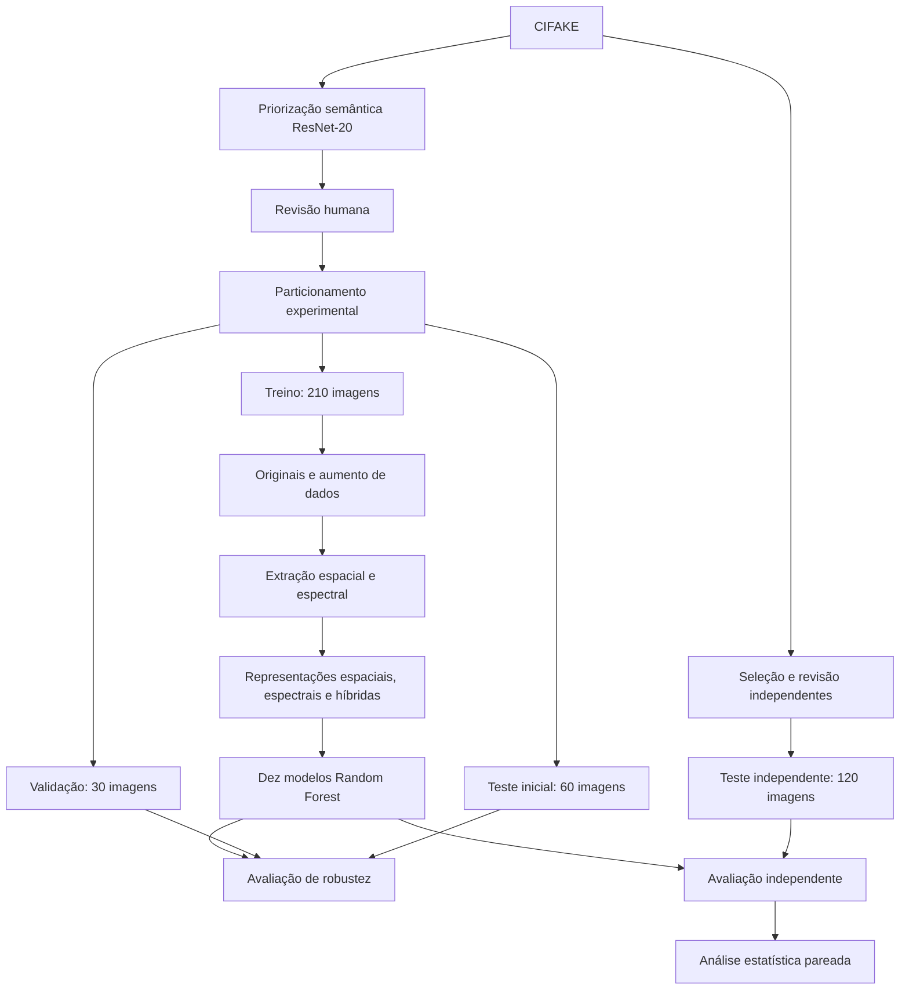
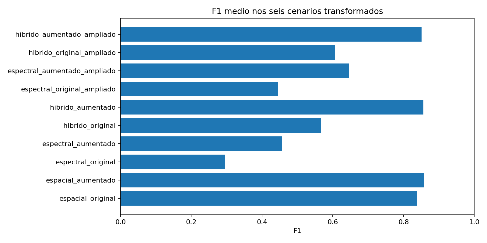
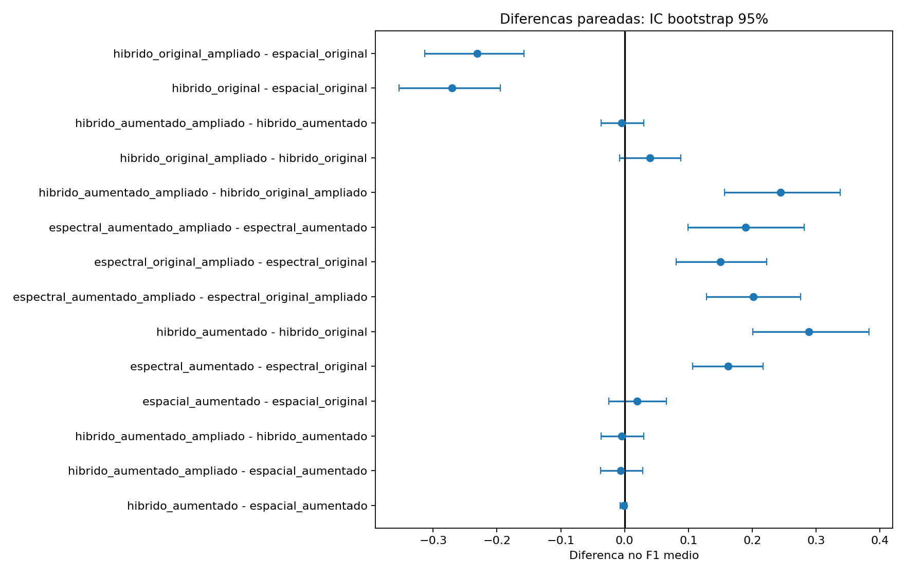

# Detecção de imagens geradas por IA

## Sobre o projeto

Projeto acadêmico de Segurança da Informação que investiga a detecção de imagens sintéticas e a sensibilidade dos classificadores a transformações digitais. O dataset definitivo é o **CIFAKE**, restrito a automóveis de passeio em imagens JPEG de 32 × 32 pixels. A avaliação independente e a análise estatística da Etapa 6 estão concluídas.

## Objetivo e pergunta de pesquisa

Como características espaciais e de frequência, isoladas ou combinadas, se comportam na detecção de imagens geradas por IA após compressão, redimensionamento e desfoque? O estudo compara Random Forest com e sem aumento de dados e uma representação espectral ampliada. Os resultados são exploratórios e restritos ao domínio investigado.

## Dataset CIFAKE

Foi utilizada a versão 3 do [CIFAKE no Kaggle](https://www.kaggle.com/datasets/birdy654/cifake-real-and-ai-generated-synthetic-images). As imagens REAL vêm do CIFAR-10; as FAKE foram geradas com Stable Diffusion 1.4. Os rótulos binários são REAL = 0 e FAKE = 1. Consulte o [artigo CIFAKE](https://doi.org/10.1109/ACCESS.2024.3356122) e seu [repositório](https://github.com/jordan-bird/CIFAKE-Real-and-AI-Generated-Synthetic-Images).

| Amostra | REAL | FAKE | Imagens de origem | Uso |
| --- | ---: | ---: | ---: | --- |
| Treino | 105 | 105 | 210 | Ajuste dos modelos |
| Validação | 15 | 15 | 30 | Comparação exploratória |
| Teste inicial | 30 | 30 | 60 | Robustez inicial |
| Teste independente | 60 | 60 | 120 | Avaliação independente |

São **420 imagens de origem selecionadas**. O teste independente usa outras imagens da partição oficial de teste do mesmo CIFAKE; não é um dataset externo. O histórico anterior de investigação GenImage está em [documentacao/historico_genimage.md](documentacao/historico_genimage.md).

## Seleção semântica e particionamento

Uma ResNet-20 pré-treinada em CIFAR-10 priorizou candidatos para revisão humana, sem decidir automaticamente a categoria. A revisão aceitou automóveis de passeio reconhecíveis, rejeitou outros veículos e marcou dúvidas como `ambiguo`. As folhas misturam classes e ocultam origem e confiança. A amostra inicial usou seed 42: treino e validação experimentais vêm do treino oficial; o teste inicial vem do teste oficial.

Para o teste independente, a seed 43 selecionou 60 imagens por classe entre as confirmadas por revisão humana. Foram excluídos os identificadores e hashes das 300 imagens anteriores e dos 4.000 candidatos históricos. A triagem dHash de 64 bits, distância de Hamming ≤ 3, não encontrou pares suspeitos; ela não garante ausência absoluta de duplicatas perceptuais. Os bytes JPEG foram preservados.

Os manifestos locais são `data/preparados/cifake/manifest.csv` e `data/preparados/cifake_teste_independente/manifest.csv`. Seus SHA-256 são, respectivamente, `6df4a531c3af61590b6f1e23c1ea99e24eebea452c7cc8e46686a96c8a764e2c` e `34bd18276507e233b8fde0f9011d3c30d4990fac7ba4c053827d5905409fb12d`.

## Fluxo metodológico



## Extração de características

As imagens são carregadas em RGB, mantidas em 32 × 32 e convertidas para `float64` em [0, 1]. A escala de cinza é `Y = 0,299 R + 0,587 G + 0,114 B`.

As **40 características espaciais** são médias e desvios padrão RGB (6), histogramas normalizados com oito intervalos fixos por canal (24), correlações de Pearson entre canais (3), médias das diferenças absolutas entre vizinhos horizontais e verticais por canal (6) e variância do Laplaciano em cinza (1). Correlações envolvendo canal constante são definidas como zero. O Laplaciano usa kernel `[[0,1,0],[1,-4,1],[0,1,0]]` e repetição da borda.

A FFT 2D é aplicada após subtração da média. Calcula-se `fftshift(fft2(Y − média))` e potência `|F|²`, normalizada pela soma na região `0 < r ≤ 0,50` ciclos/pixel. Excluem-se DC e os cantos fora dessa região, que contém 794 coeficientes. O perfil exploratório tem 16 intervalos radiais; a grade tem passo de 1/32 ciclo/pixel.

| Representação | Entradas | Dimensão |
| --- | --- | ---: |
| Espacial | Estatísticas, histogramas, correlações, diferenças e Laplaciano | 40 |
| Espectral original | E1, E2, E3 | 3 |
| Espectral ampliada | E1, E2, E3, B2, B3, B4, centróide, entropia | 8 |
| Híbrida original | Espacial + espectral original | 43 |
| Híbrida ampliada | Espacial + espectral ampliada | 48 |

Os identificadores, rótulos, caminhos e partições são metadados, não entradas. A ordem das características é registrada nos relatórios dos modelos. Para imagens de energia espectral nula, os vetores espectrais são definidos como zero e o caso é registrado.

## Classificadores Random Forest

São **dez classificadores**, um para cada representação com treino original e outro com aumento de dados. Cada floresta calcula a média das probabilidades de classe estimadas pelas árvores e escolhe a classe de maior média; em empate, a decisão padrão favorece a primeira classe, REAL. FAKE é a classe positiva.

Todos usam `n_estimators=300`, `max_depth=6`, `min_samples_split=4`, `min_samples_leaf=2`, `max_features=1.0`, `criterion="gini"`, `bootstrap=True`, `random_state=42` e `n_jobs=-1`. Não houve busca de hiperparâmetros nem ajuste de limiar. A importância por redução de impureza não demonstra causalidade e pode ser afetada por correlações.

## Transformações digitais

Cada transformação parte da imagem original, sem encadeamento. Os sete cenários são: original; JPEG 75 e 30 em memória, com `subsampling=0`, `optimize=False`, `progressive=False`; resize 32→24→32 e 32→16→32, com Lanczos na redução e bilinear no retorno; e blur gaussiano com sigma 0,5 e 1,0, bordas `reflect`, `truncate=4`, sem mistura de canais e com arredondamento para RGB de 8 bits. O retorno ao tamanho original não recupera informação perdida. As imagens já possuem compressão JPEG histórica.

## Data Augmentation

Cada uma das 210 imagens de treino fornece a versão original e seis transformadas: **1.470 instâncias**, com 735 por classe. As versões são dependentes da mesma imagem de origem. Validação e teste não entram no ajuste. A aplicação do princípio de aumento a Random Forest adapta, sem reproduzir integralmente, a investigação com redes neurais de [Wang et al. (2020)](https://openaccess.thecvf.com/content_CVPR_2020/html/Wang_CNN-Generated_Images_Are_Surprisingly_Easy_to_Spot..._for_Now_CVPR_2020_paper.html).

## Ampliação espectral

As sete faixas são B1 `(0; 0,0625)`, B2 `[0,0625; 0,125)`, B3 `[0,125; 0,1875)`, B4 `[0,1875; 0,25)`, E1 `[0,25; 0,3125)`, E2 `[0,3125; 0,375)` e E3 `[0,375; 0,50]`. E1–E3 são as três entradas espectrais originais. A versão ampliada adiciona B2–B4, centróide `Σ rᵢpᵢ` e entropia normalizada `−Σ pᵢ ln(pᵢ)/ln(K)`, com `0 ln(0) = 0`.

B1 é diagnóstico: as sete energias somam 1 quando a energia é não nula. Etotal também não é entrada, pois é a soma de E1–E3. Os modelos e vetores anteriores permanecem inalterados.

## Avaliação independente

Os dez modelos congelados foram avaliados nas 120 imagens independentes e seus sete cenários: **840 instâncias**, **70 combinações** e **8.400 predições individuais**. A métrica principal congelada é o F1 médio nos seis cenários transformados. Acurácia, precisão, recall, F1, especificidade e matrizes de confusão também foram registradas. As comparações são pareadas pelo identificador da imagem.

## Resultados e análise estatística

| Modelo | F1 original | F1 médio transformado | Pior F1 transformado |
| --- | ---: | ---: | ---: |
| Espacial original | 0,883 | 0,837 | 0,741 |
| Espacial aumentado | 0,876 | 0,857 | 0,818 |
| Espectral original | 0,667 | 0,295 | 0,085 |
| Espectral aumentado | 0,628 | 0,457 | 0,351 |
| Espectral ampliado original | 0,720 | 0,445 | 0,213 |
| Espectral ampliado aumentado | 0,718 | 0,646 | 0,588 |
| Híbrido original | 0,831 | 0,567 | 0,342 |
| Híbrido aumentado | 0,876 | 0,856 | 0,809 |
| Híbrido ampliado original | 0,821 | 0,606 | 0,444 |
| Híbrido ampliado aumentado | 0,855 | 0,851 | 0,803 |

O aumento de dados elevou numericamente o F1 médio transformado nas cinco representações; no espacial, o IC da diferença inclui zero. A ampliação espectral beneficiou principalmente os modelos exclusivamente espectrais. O espacial e os híbridos aumentados ficaram próximos; a superioridade numérica híbrida observada na validação não se confirmou no teste independente.

O bootstrap usa **10.000 reamostragens**, seed 42, estratificadas por classe e pareadas por imagem, preservando todos os cenários e modelos. Os ICs percentis de 95% abaixo são calculados diretamente sobre as diferenças de F1 médio transformado:

| Comparação: segundo menos primeiro | Diferença | IC 95% |
| --- | ---: | ---: |
| Espacial aumentado → híbrido aumentado | −0,0010 | [−0,0068; 0,0038] |
| Espacial aumentado → híbrido ampliado aumentado | −0,0060 | [−0,0374; 0,0281] |
| Híbrido aumentado → híbrido ampliado aumentado | −0,0049 | [−0,0369; 0,0298] |

Um intervalo que inclui zero não demonstra equivalência. Os ICs são condicionais aos modelos treinados e não incluem variação de novos treinamentos; as comparações são exploratórias. Veja [tabelas](resultados/analise_final/tabelas/), [síntese](resultados/analise_final/sintese_resultados.md) e [relatório](resultados/analise_final/relatorio.json).





## Instalação e dependências

Na raiz do projeto, com Python 3.12 e PowerShell:

```powershell
python -m venv .venv
.\.venv\Scripts\python.exe -m pip install -r requirements.txt
.\.venv\Scripts\python.exe -m pip install -r requirements-semantic.txt
```

O segundo arquivo é necessário para a ResNet-20 de priorização. Código e pesos adicionais da revisão `786c16252c0fc58ee9adac063f8337cc4a7a497a` devem estar nos caminhos previstos em `preparacao_dados/selecao_semantica.py`; a implementação verifica seus hashes. O arquivo de pesos `cifar10_resnet20-4118986f.pt` e o código do modelo devem ser obtidos do [projeto oficial](https://github.com/chenyaofo/pytorch-cifar-models/tree/786c16252c0fc58ee9adac063f8337cc4a7a497a).

## Reprodução dos experimentos

O diretório `data/` é ignorado pelo Git. Obtenha a versão 3 do CIFAKE pela fonte indicada e extraia os diretórios oficiais em `data/raw/cifake/`, preservando nomes e bytes. Os CSVs de revisão e os mapas precisam estar disponíveis em `resultados/cifake/` e `resultados/melhorias/teste_independente/`; o manifesto independente também depende do protocolo e das anotações preservadas. A reconstrução é possível com esses arquivos e os dados originais íntegros, mas não há garantia de reprodução byte a byte dos modelos em ambientes ou versões diferentes. Confira os hashes registrados antes de reutilizá-los.

Os comandos abaixo usam `python` para representar o Python do ambiente virtual. **Leia os efeitos antes de executá-los:**

```powershell
# Reconstruir a amostra inicial a partir das anotações existentes
python -m preparacao_dados.cifake prepare

# Análise e extração das características iniciais
python -m analise_frequencias.explorar
python -m extracao_caracteristicas.extrair --saida resultados/caracteristicas_reproducao

# Preparação da amostra independente, seguida de revisão humana
python -m preparacao_independente.preparar preparar
python -m preparacao_independente.preparar revisar
python -m preparacao_independente.preparar status
python -m preparacao_independente.finalizar

# Avaliação dos modelos congelados e consolidação
python -m melhorias.avaliacao_independente --saida resultados/melhorias/teste_independente/avaliacao_reproducao
python -m analise_resultados.consolidar --saida resultados/analise_final_reproducao
```

`cifake prepare` depende das anotações históricas e pode gravar no destino e resumo originais; faça backup antes. `analise_frequencias.explorar` sobrescreve `resultados/frequencias/`; a extração aceita `--saida`, mas grava nos arquivos desse destino. A preparação independente recusa candidatos existentes; a revisão altera o CSV de anotações e depende de intervenção humana; a finalização recusa destino existente e exige cotas e verificações de integridade. Avaliação e consolidação recusam pastas de saída existentes e exigem os manifestos, protocolo, modelos e resultados prévios.

Para reconstruir modelos e resultados intermediários, os pontos de entrada são `python -m treinamento.treinar`, `python -m experimentos.robustez`, `python -m melhorias.treinamento_robusto` e `python -m melhorias.treinamento_espectro_ampliado`. **Eles treinam ou avaliam novamente e sobrescrevem saídas em seus diretórios padrão**; preserve os artefatos antes de usá-los. A avaliação independente e a consolidação usam os modelos e predições congelados e não exigem novo treinamento.

## Estrutura de diretórios

```text
preparacao_dados/          preparação CIFAKE e ferramentas históricas GenImage
analise_frequencias/       FFT e exploração radial
extracao_caracteristicas/  características espaciais e espectrais originais
treinamento/               treinamento e métricas dos modelos iniciais
experimentos/              transformações e robustez inicial
melhorias/                 aumento, espectro ampliado e avaliação independente
preparacao_independente/   candidatos, revisão e finalização
analise_resultados/        consolidação, ablação e bootstrap
testes/                    testes automatizados
resultados/                resultados e relatórios por etapa
documentacao/              histórico GenImage
data/                      dados locais ignorados pelo Git
```

## Testes automatizados

```powershell
.\.venv\Scripts\python.exe -m unittest discover -s testes -v
```

Na última execução, **48 testes passaram**. Eles cobrem processamento, características, partições, integridade, métricas e bootstrap. Alguns testes existentes ajustam pequenos classificadores temporários; não substituem os dez modelos experimentais.

## Limitações

O treino é pequeno, a validação tem apenas 30 imagens e a resolução de 32 × 32 limita a análise. Há uma única categoria semântica, um gerador específico, JPEG histórico, possíveis vieses do CIFAKE e seleção semântica assistida. As variantes de uma imagem não são independentes. As transformações avaliadas são conhecidas pelos modelos aumentados; o estudo não demonstra robustez a transformações inéditas nem generalização direta a outros datasets ou geradores. Falsos positivos podem contestar imagens autênticas; falsos negativos podem aceitar imagens sintéticas como autênticas.

## Trabalhos futuros

- Organizar o CIFAKE em múltiplos subconjuntos semânticos e comparar classificadores específicos por categoria, generalização entre categorias e classificadores generalistas.
- Investigar Late Fusion, transformações não utilizadas no treinamento e imagens de maior resolução.

## Referências

- Bird e Lotfi. [CIFAKE: Image Classification and Explainable Identification of AI-Generated Synthetic Images](https://doi.org/10.1109/ACCESS.2024.3356122).
- Wang et al. [CNN-Generated Images Are Surprisingly Easy to Spot... for Now](https://openaccess.thecvf.com/content_CVPR_2020/html/Wang_CNN-Generated_Images_Are_Surprisingly_Easy_to_Spot..._for_Now_CVPR_2020_paper.html), CVPR 2020.
- [Código e pesos da ResNet para CIFAR-10](https://github.com/chenyaofo/pytorch-cifar-models/tree/786c16252c0fc58ee9adac063f8337cc4a7a497a).
